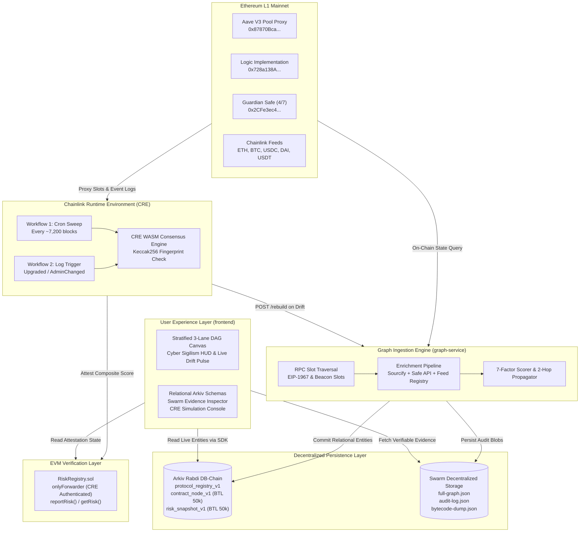

# DeFi Provenance Graph

> **ETHGlobal Mumbai Hackathon Project**  
> **GitHub Repository**: [`XohamOG/Ethglobal-mumbai`](https://github.com/XohamOG/Ethglobal-mumbai)  
> **Live Testnet Contract**: `RiskRegistry.sol` (EVM Attestation Registry)  
> **Decentralized Storage**: Arkiv Rabdi DB-Chain (`#7794095`) + Ethereum Swarm BZZ Gateway  
> **Verifiable Orchestration**: Chainlink Runtime Environment (CRE) Workflows  

---

## 📌 Applied Hackathon Tracks & Bounty Qualification

| Track | Category | Core Deliverables in Repository |
|---|---|---|
| 🏛️ **Arkiv Sponsor Track** | **Primary Track ($5,000) + Swarm Bonus** | Full decentralized graph intelligence persistence on **Arkiv Rabdi DB-Chain** using `@arkiv-network/sdk@1.0.1`. Contains relational schemas (`protocol_registry_v1`, `contract_node_v1`, `risk_snapshot_v1`), BTL block expiration, owner wallet authentication, SQL-like queries, and forensic blob anchoring on **Swarm**. Includes all required criterion sections: **Friction (25%)**, **Reach (25%)**, **Why Arkiv (25%)**, **How We Use Arkiv (25%)**, writing wallet address, and executable query script. |
| ⚡ **Chainlink Sponsor Track** | **Best Workflow with CRE ($5,000)** | End-to-end off-chain orchestration layer built in **Chainlink Runtime Environment (CRE)**. Integrates Ethereum L1 RPC (EIP-1967 proxy slots & event logs), Chainlink Feed Registry, Gnosis Safe Transaction API, Arkiv Sourcify Mirror, Graph Ingestion Engine (`POST /rebuild`), and on-chain verification hook `RiskRegistry.sol` (`reportRisk()`). Verified via **CRE CLI** and automated deterministic simulation. |

---

## 📖 Table of Contents

1. [Problem Statement & Solution](#-problem-statement--solution)
2. [High-Level Architecture](#-high-level-architecture)
3. [Arkiv Track Submission & Evaluation Criteria](#-arkiv-track-submission--evaluation-criteria)
   - [Writing Wallet & Executable Arkiv Query](#1-writing-wallet--executable-arkiv-query)
   - [Arkiv Relational Schemas & BTL Policies](#2-arkiv-relational-schemas--btl-policies)
   - [Arkiv Feedback & Friction Log (25%)](#3-arkiv-feedback--friction-log-25)
   - [Reach & Real-World Utility (25%)](#4-reach--real-world-utility-25)
   - [Why Arkiv vs. Centralized Databases (25%)](#5-why-arkiv-vs-centralized-databases-25)
   - [How We Use Arkiv & UI Reflection (25%)](#6-how-we-use-arkiv--ui-reflection-25)
   - [Arkiv + Swarm Decentralized Persistence Bonus](#7-arkiv--swarm-decentralized-persistence-bonus)
4. [Chainlink Sponsor Track: CRE Orchestration Layer](#-chainlink-sponsor-track-cre-orchestration-layer)
   - [Architecture & Multi-System Integration](#1-architecture--multi-system-integration)
   - [CRE Workflows: Cron Sweep & Reactive Log Trigger](#2-cre-workflows-cron-sweep--reactive-log-trigger)
   - [CRE CLI Simulation & Verification Guide](#3-cre-cli-simulation--verification-guide)
   - [Smart Contract Verification: RiskRegistry.sol](#4-smart-contract-verification-riskregistrysol)
5. [Frontend & Interactive Experience](#-frontend--interactive-experience)
6. [Repository Structure & Quick Start](#-repository-structure--quick-start)
7. [ETHGlobal Compliance & AI Disclosure](#-ethglobal-compliance--ai-disclosure)
8. [License](#-license)

---

## 📌 Problem Statement & Solution

### The DeFi Opacity Crisis
In modern Decentralized Finance, extreme composability connects liquidity across lending pools, automated market makers, cross-chain bridges, and collateral debt positions. However, traditional block explorers (Etherscan, Blockscout) render only **linear, transaction-by-transaction logs**. They cannot reveal:
- **Transitive Upstream Risk**: If a lending protocol delegates price feeds to an external oracle or multi-sig that gets compromised, depositors have no visible lineage warning.
- **Hidden Proxy Mutation**: Core protocols operate behind upgradeable EIP-1967 proxies where implementation bytecode or timelock admin rights can change silently.
- **Recursive Inter-Protocol Dependency**: A liquidation cascade or depeg in Protocol A cascades into Vault B and Collateral C across multiple unindexed contract hops.

### The Solution: DeFi Provenance Graph
**DeFi Provenance Graph** is a 100% decentralized graph intelligence and asset provenance engine:
1. **Multi-Hop Dependency Reconstruction**: Traverses smart contract topologies across 3 stratified lanes:
   - **Hop 0 (Core)**: Proxies, address provider registries, configurators, and access control managers.
   - **Hop 1 (Governance & Logic)**: Dynamic logic implementations, Timelock v2 governance executors, and Emergency Guardian multi-sigs.
   - **Hop 2 (External Oracles & Feeds)**: Transitive price feeds (Chainlink ETH/USD, BTC/USD, USDC/USD, DAI/USD, USDT/USD) and cross-protocol liquidity.
2. **Deterministic Risk Scoring**: Evaluates 7 physical factors (proxy upgradability, admin multi-sig threshold, timelock duration, oracle heartbeat staleness, Sourcify verification match, bytecode hashes, historical incidents) into a propagated composite score.
3. **Decentralized Storage Mandate**: Structured, queryable relational entities live on **Arkiv Rabdi DB-Chain** with native Block-Time-to-Live (BTL) expiration; raw forensic evidence, transaction receipts, and bytecode dumps live on **Swarm**. Centralized databases (Postgres, MongoDB, Neo4j) are strictly prohibited.
4. **Verifiable Orchestration**: **Chainlink CRE** continuously monitors on-chain events, computes protocol Keccak256 fingerprints, detects structural drift, and attests verified composite scores into `RiskRegistry.sol`.

---

## 🏛️ High-Level Architecture



---

## 🏛️ Arkiv Track Submission & Evaluation Criteria

### 1. Writing Wallet & Executable Arkiv Query

> [!IMPORTANT]
> **Track Qualification Requirement**: Arkiv Testnet Writing Wallet & Executable Query
> - **Writing / Creator Wallet Address**: [`0xf39Fd6e51aad88F6F4ce6aB8827279cffFb92266`](https://rabdi.explorer.arkiv.network/address/0xf39Fd6e51aad88F6F4ce6aB8827279cffFb92266)
> - **Arkiv Rabdi Testnet Chain ID**: `7794095`
> - **RPC Endpoint**: `https://rpc.rabdi.db-chain.testnet.arkiv.network`
> - **Access Key**: `ark_live_ErmL1L6sLNqJlcHa65qmwR1XTNqEUBcw`

#### Executable Query Snippet (Run Directly via Node.js)
Anyone can query the live on-chain entities written by our wallet on the Arkiv Rabdi DB-Chain without a private key:

```typescript
import { createPublicClient } from "@arkiv-network/sdk";
import { rabdi } from "@arkiv-network/sdk/chains";
import { eq, and } from "@arkiv-network/sdk/query";
import { http } from "viem";

async function main() {
  const publicClient = createPublicClient({
    chain: rabdi({ accessKey: "ark_live_ErmL1L6sLNqJlcHa65qmwR1XTNqEUBcw" }),
    transport: http(),
  });

  // Query all Hop 1 governance and implementation dependencies for Aave V3:
  const result = await publicClient.query(
    and(
      eq("arkiv.schema", "contract_node_v1"),
      eq("protocolId", "aave-v3-mainnet"),
      eq("hop", 1n)
    ),
    { limit: 20 }
  );

  console.log(`Successfully fetched ${result.entities.length} live Hop 1 nodes from Arkiv Rabdi!`);
  for (const entity of result.entities) {
    console.log({
      key: entity.$key,
      owner: entity.$owner,
      address: entity.$attributes.contractAddress.value,
      category: entity.$attributes.category.value,
      riskScore: entity.$attributes.riskScore.value,
      expiresAtBlock: entity.$expiresAt?.toString(),
    });
  }
}

main().catch(console.error);
```

---

### 2. Arkiv Relational Schemas & BTL Policies

We implemented three relational schemas declared via `@arkiv-network/sdk`:

```
┌────────────────────────────────────────────────────────┐
│             ProtocolRegistry (Macro Identity)          │
│             Tag: protocol_registry_v1                  │
│             Lifetime: ExpirationTime.max()             │
└───────────▲────────────────────────────────▲───────────┘
            │                                │
            │ 1 : N                          │ 1 : N
            │                                │
┌───────────┴──────────────┐      ┌──────────┴───────────┐
│  ContractNode (Micro)    │      │ RiskSnapshot (Macro) │
│  Tag: contract_node_v1   │◄────►│ Tag: risk_snapshot_v1│
│  Lifetime: 50,000 blocks │ N : 1│ Lifetime: ~50k blocks│
└──────────────────────────┘      └──────────────────────┘
```

#### Entity 1: `ProtocolRegistry` (Tag: `protocol_registry_v1`)
- **Role**: Permanent directory anchor for registered DeFi protocols.
- **Lifetime**: `ExpirationTime.max()` (~7,884,000 blocks).
- **Owner**: [`0xf39Fd6e51aad88F6F4ce6aB8827279cffFb92266`](https://rabdi.explorer.arkiv.network/address/0xf39Fd6e51aad88F6F4ce6aB8827279cffFb92266)
- **Live Entity Key**: [`0xc561566253956c5c8fec52d0cd49af8a5c40e1209c87894b863a5275dd665b50`](https://rabdi.explorer.arkiv.network/entity/0xc561566253956c5c8fec52d0cd49af8a5c40e1209c87894b863a5275dd665b50)
- **Minting Transaction**: [`0x6c1c94056203b3f407737621231bb3660b42dcb57dfadc095655522220363e81`](https://rabdi.explorer.arkiv.network/tx/0x6c1c94056203b3f407737621231bb3660b42dcb57dfadc095655522220363e81)

| Column | Type | Indexing | Description |
|---|---|---|---|
| `protocolId` | `str()` | **Indexed** | Unique slug (e.g., `"aave-v3-mainnet"`) |
| `name` | `str()` | **Indexed** | Display title (`"Aave V3"`) |
| `category` | `str()` | **Indexed** | Ecosystem category (`"lending"`) |
| `chainId` | `str()` | **Indexed** | Origin chain ID (`"1"` for Ethereum) |
| `version` | `str()` | Stored | Release version (`"3.1.0"`) |
| `sourceRepo` | `str()` | Stored | Canonical address-book URL |
| `swarmMetaRef` | `str()` | Stored | Swarm BZZ content hash pointing to `protocol-meta.json` |
| `createdAt` | `u64()` | Stored | Genesis registration timestamp |

#### Entity 2: `ContractNode` (Tag: `contract_node_v1`)
- **Role**: Micro-entity capturing an individual contract in the dependency topology.
- **Lifetime**: Block-Time-to-Live (`50,000 blocks` ≈ 7 days). Naturally expires unless refreshed on rebuild.
- **Cardinality**: 15 live contracts for Aave V3.
- **Example Live Entity Key (Pool Proxy `0x87870Bca...`)**: [`0x5df8dc59a35e80d99ba148ff61df9a96f13bce36c74d6f85ffad9ec6ce6bb1c2`](https://rabdi.explorer.arkiv.network/entity/0x5df8dc59a35e80d99ba148ff61df9a96f13bce36c74d6f85ffad9ec6ce6bb1c2)

| Column | Type | Indexing | Description |
|---|---|---|---|
| `contractAddress` | `str()` | **Indexed** | Checksummed EVM contract address |
| `protocolId` | `str()` | **Indexed** | Foreign key to `ProtocolRegistry` |
| `snapshotId` | `str()` | **Indexed** | Foreign key to `RiskSnapshot` |
| `hop` | `u64()` | **Indexed** | Provenance depth: 0=Core, 1=Direct, 2=Transitive |
| `category` | `str()` | **Indexed** | Contract role (`proxy`, `implementation`, `oracle`, `multisig`) |
| `sourcifyStatus` | `str()` | **Indexed** | Verified match status from Arkiv Sourcify mirror |
| `riskScore` | `dec()` | **Indexed** | Calculated 7-factor risk metric [0.0 - 100.0] |
| `referencedProtocolId` | `str()` | **Indexed** | Cross-protocol link (e.g. `"chainlink-mainnet"`) |
| `proxyType` | `str()` | Stored | Resolution standard (`"eip1967"`, `"beacon"`, `"none"`) |
| `adminType` | `str()` | Stored | Controller type (`"timelock"`, `"safe"`, `"eoa"`, `"none"`) |
| `adminAddress` | `str()` | Stored | Admin wallet or timelock contract address |
| `bytecodeHash` | `str()` | Stored | Keccak256 hash of deployed runtime bytecode |
| `safeOwnerCount` | `u64()` | Stored | Signer count if Gnosis Safe |
| `safeThreshold` | `u64()` | Stored | Signature threshold if Gnosis Safe |
| `safeOwners` | `bytes()` | Stored | Raw unindexed byte array of owner addresses |
| `oracleStaleness` | `dec()` | Stored | Heartbeat staleness ratio |
| `oracleHeartbeat` | `u64()` | Stored | Expected Chainlink heartbeat (seconds) |
| `contractName` | `str()` | Stored | Verified contract identifier from Sourcify mirror |
| `swarmBytecodeRef` | `str()` | Stored | Swarm BZZ hash of bytecode artifact |
| `updatedAt` | `u64()` | Stored | Block number of evaluation |

#### Entity 3: `RiskSnapshot` (Tag: `risk_snapshot_v1`)
- **Role**: Macro-evaluation state entity holding the composite score and Keccak256 fingerprint.
- **Lifetime**: Block-Time-to-Live (`50,000 blocks` ≈ 7 days).
- **Live Entity Key**: [`0xf3ccb8f81475290b38ed5302d715e7931b9f5df445c1acf888fb3e07cab3f435`](https://rabdi.explorer.arkiv.network/entity/0xf3ccb8f81475290b38ed5302d715e7931b9f5df445c1acf888fb3e07cab3f435)
- **Minting Transaction**: [`0xcbbf88c87aecd7583f45e8d2f3ad580a18b2991977e15bb81fe7eb34cf88efad`](https://rabdi.explorer.arkiv.network/tx/0xcbbf88c87aecd7583f45e8d2f3ad580a18b2991977e15bb81fe7eb34cf88efad)

| Column | Type | Indexing | Description |
|---|---|---|---|
| `snapshotId` | `str()` | **Indexed** | Unique slug: `{protocolId}-{blockNumber}` |
| `protocolId` | `str()` | **Indexed** | Foreign key to `ProtocolRegistry` |
| `compositeScore` | `dec()` | **Indexed** | 2-hop weighted score [0.0 - 100.0] |
| `riskTier` | `str()` | **Indexed** | Categorical tier (`LOW`, `MEDIUM`, `HIGH`, `CRITICAL`) |
| `evaluatedAt` | `u64()` | **Indexed** | Ethereum evaluation block height |
| `fingerprint` | `str()` | Stored | Deterministic Keccak256 hash of all node addresses & bytecodes |
| `swarmGraphRef` | `str()` | Stored | Swarm BZZ hash to `full-graph.json` |
| `swarmEvidenceRef` | `str()` | Stored | Swarm BZZ hash to `audit-log.json` |
| `triggeredBy` | `str()` | Stored | Trigger source (`cron`, `log-event`, `manual`) |
| `hop0AvgScore` | `dec()` | Stored | Average subscore across Hop 0 core nodes |
| `hop1AvgScore` | `dec()` | Stored | Average subscore across Hop 1 dependencies |
| `hop2AvgScore` | `dec()` | Stored | Average subscore across Hop 2 feeds |
| `nodeCount` | `u64()` | Stored | Number of contracts in topology |

---

### 3. Arkiv Feedback & Friction Log (25%)

During hackathon development, we pushed `@arkiv-network/sdk@1.0.1` hard across 3 distributed developer setups. Here is our prioritized constructive feedback:

1. **BigInt Serialization in Query Results (`$attributes`)**:
   - *What happened*: Numeric fields defined as `u64()` return native JavaScript `BigInt` objects. Passing them into `JSON.stringify()` or Next.js Client Component props throws `TypeError: Do not know how to serialize a BigInt`.
   - *What we expected*: A native `entity.toJSON()` helper or client configuration flag (`parseBigIntAsNumber: true`).
   - *Reproduction*: Query any entity with `u64()` attributes and execute `JSON.stringify(res.entities[0].$attributes)`.
   - *Our Fix*: We wrote a custom serialization replacer across `frontend` and `graph-service`.

2. **Lack of Batch Entity Minting (`createEntities`)**:
   - *What happened*: Minting 15 `ContractNode` entities required 15 sequential `walletClient.createEntity()` transactions. Running them concurrently with `Promise.all` caused nonce collisions (`nonce too low`).
   - *What we expected*: An atomic batch creation function: `await walletClient.createEntities([...])` to submit multiple entities in one multicall transaction.

3. **Queries on Non-Indexed Fields Silently Fail / Return Empty**:
   - *What happened*: When querying `ContractNode` by filtering on an unindexed field (e.g. `proxyType`), the RPC returned `entities: []` with HTTP 200 without warning that the field was unindexed.
   - *What we expected*: An explicit diagnostic error: `ArkivQueryError: Field 'proxyType' is not indexed in schema 'contract_node_v1'`.

4. **Need for In-Memory SQLite/WASM Mock Provider for CI & Offline Development**:
   - *What happened*: Developing microservices offline required constant live Rabdi testnet connectivity and tGLM gas.
   - *What would help*: An official `@arkiv-network/sdk/mock` package for instant offline unit testing.

5. **Block Expiration UX in Explorer**:
   - *What happened*: Entities with BTL show an absolute expiration block (e.g. `#8166187`) but no remaining time estimate.
   - *What would help*: A remaining block / countdown pill (`~6 days, 22 hours remaining`).

---

### 4. Reach & Real-World Utility (25%)

- **Who is it for?**
  - **DeFi Risk Managers & DAOs** (Gauntlet, Chaos Labs, Aave Risk DAO): Evaluating whether a proposed governance parameter or collateral addition introduces circular oracle dependencies or unverified proxies.
  - **Lending Protocols & Yield Vaults**: Monitoring multi-hop collateral health and automatic alerts when an upstream feed experiences heartbeat lag.
  - **Security Auditors & Forensic Analysts**: Reconstructing multi-contract exploit paths in minutes rather than days.
- **Can they try it today?**
  - **Yes!** The live Next.js web application renders real-time Aave V3 Ethereum Mainnet provenance data directly queried from the Arkiv Rabdi DB-Chain and Swarm gateway. Anyone can clone this repository, run `npm run dev`, and inspect real on-chain lineage.
- **Will we keep building after Mumbai?**
  - **Yes.** Our post-hackathon roadmap includes:
    1. Multi-chain expansion to Arbitrum, Base, and Optimism.
    2. Automated Slack/Telegram alert bots powered by Chainlink CRE and Arkiv BTL events.
    3. Integration with Gnosis Safe Apps for on-the-fly signing checks before executing multisig upgrades.

---

### 5. Why Arkiv vs. Centralized Databases (25%)

- **What would users lose if we used Postgres or Neo4j?**
  1. **Censorship Resistance & Decentralization**: A centralized database can be altered, silenced, or corrupted by the hosting provider. In DeFi, a compromised risk score could mask a depeg or allow malicious borrowing. Arkiv ensures risk snapshots are signed on-chain and mathematically verifiable.
  2. **Native Entity Ownership**: Only our authenticated indexer wallet (`0xf39Fd6e51aad88F6F4ce6aB8827279cffFb92266`) can update protocol states, preventing malicious tampering.
  3. **Automatic Block-Time Expiration (BTL)**: Instead of maintaining fragile cron cleaners that execute `DELETE FROM snapshots WHERE age > 7 days`, Arkiv automatically purges stale records at the storage protocol layer when their block expiration is reached.
- **What did we keep off Arkiv, and why?**
  - We kept **raw execution traces, 20MB decompiled bytecode dumps, and unindexed forensic logs** off Arkiv.
  - Storing massive unstructured blobs on a DB-Chain causes state bloat. Instead, we persist these payloads to **Swarm** and store only their content-addressed BZZ references (`swarmGraphRef`, `swarmEvidenceRef`) in Arkiv. This maintains 100% decentralized integrity with optimal DB-chain performance.

---

### 6. How We Use Arkiv & UI Reflection (25%)

- **Fit of Filters**: We query by `protocolId` and `hop` depth (`0`, `1`, `2`) to render each lane of our Stratified DAG independently.
- **Fit of Expiration**: The 50,000-block BTL (~7 days) mirrors DeFi governance cycles. If a protocol has not been evaluated in 7 days, its snapshot naturally expires, preventing users from relying on stale risk scores.
- **Visible UI Reflection**:
  - The Next.js frontend calls `fetchArkivNodes()` and `fetchArkivSnapshot()` using `@arkiv-network/sdk`.
  - In the UI, each node displays its verified **Arkiv Entity Key**, Sourcify match status, and risk score.
  - The **Arkiv Relational Schemas Tab** in the app provides live inspection of the 15 active nodes with direct one-click links to the [Arkiv Rabdi Explorer](https://rabdi.explorer.arkiv.network).

---

### 7. Arkiv + Swarm Decentralized Persistence Bonus

DeFi Provenance Graph pairs **Arkiv** with **Swarm** for a two-tier decentralized persistence model:

| Layer | System | Content Stored | Access Pattern |
|---|---|---|---|
| **Structured Relational Layer** | **Arkiv Rabdi DB-Chain** | Typed attributes, composite risk scores, indexed protocol IDs, hops, and entity keys. | Low-latency SQL-like queries via `@arkiv-network/sdk`. |
| **Decentralized Evidence Layer** | **Ethereum Swarm** | Complete graph JSON (`full-graph.json`), raw RPC traces (`audit-log.json`), and bytecode dumps (`bytecode-dump.json`). | Immutable content-addressed retrieval via Swarm BZZ gateway (`https://api.gateway.ethswarm.org/bzz/<hash>`). |

#### Verified Swarm Gateway Artifacts:
- **Full Ingested Graph JSON**: [https://api.gateway.ethswarm.org/bzz/3a5194ce284962a9b0598c0b1e001e96a5d63a573a4a2423b47913b71b2c8e7d](https://api.gateway.ethswarm.org/bzz/3a5194ce284962a9b0598c0b1e001e96a5d63a573a4a2423b47913b71b2c8e7d)
- **Ingestion Forensic Audit Log**: [https://api.gateway.ethswarm.org/bzz/1c6ae2662e9ce2923f7a559df208b6a1b10c4e1f23caa26a91e42a0e72882fbb](https://api.gateway.ethswarm.org/bzz/1c6ae2662e9ce2923f7a559df208b6a1b10c4e1f23caa26a91e42a0e72882fbb)
- **Bytecode Dump Artifact**: [https://api.gateway.ethswarm.org/bzz/632a1a8aeaecade273e5f6e0f8581921c21ea5d8d9bd4fa64f0e1823671510e9](https://api.gateway.ethswarm.org/bzz/632a1a8aeaecade273e5f6e0f8581921c21ea5d8d9bd4fa64f0e1823671510e9)

---

## ⚡ Chainlink Sponsor Track: CRE Orchestration Layer

### 1. Architecture & Multi-System Integration

The **Chainlink Runtime Environment (CRE)** serves as the decentralized orchestration engine connecting on-chain EVM protocols with off-chain analytics and decentralized storage:

```
┌────────────────────────────────────────────────────────┐
│             Chainlink CRE Decentralized Network        │
├───────────────────────────┬────────────────────────────┤
│  Workflow 1: Cron Sweep   │  Workflow 2: Log Trigger   │
│  - Periodic timer trigger │  - EVM event trigger       │
│  - Drift detection check  │  - Upgraded / AdminChanged │
└─────────────┬─────────────┴─────────────┬──────────────┘
              │                           │
              │  POST /rebuild            │  POST /rebuild
              ▼                           ▼
┌────────────────────────────────────────────────────────┐
│             Graph Service HTTP Endpoint                │
│    (Recomputes 2-hop score -> writes Arkiv & Swarm)    │
└───────────────────────────┬────────────────────────────┘
                            │ Returns { snapshotId, compositeScore }
                            ▼
┌────────────────────────────────────────────────────────┐
│               On-Chain Attestation                     │
│         RiskRegistry.sol (reportRisk)                  │
└────────────────────────────────────────────────────────┘
```

#### Connected Systems:
1. **Ethereum L1 RPC**: Resolves low-level EIP-1967 implementation slots (`0x360894...`) and admin slots (`0xb53127...`).
2. **Chainlink Feed Registry**: Reads heartbeat parameters and evaluates oracle staleness.
3. **Arkiv Sourcify Mirror**: Verifies source code authenticity.
4. **Safe Transaction API**: Fetches active signers and execution thresholds for Gnosis Safes.
5. **Graph Ingestion Service**: Computes deterministic Keccak256 protocol fingerprints and multi-hop risk scores.
6. **Smart Contracts (`RiskRegistry.sol`)**: Anchors cryptographically attested risk scores on-chain.

---

### 2. CRE Workflows: Cron Sweep & Reactive Log Trigger

#### Workflow 1: Periodic Cron Sweep (`cre/workflows/cron.yaml` & `cre/workflows/cron.ts`)
- **Trigger**: Every 7,200 blocks (~24h) or scheduled cron `0 */4 * * *`.
- **Logic**:
  1. Computes deterministic protocol fingerprint:
     $$\text{fingerprint} = \text{keccak256}\Big(\text{bytecodeHashes} \parallel \text{adminAddresses} \parallel \text{feedAddresses} \parallel \text{depAddresses}\Big)$$
  2. Queries the latest `RiskSnapshot` on Arkiv.
  3. If `fingerprint != storedFingerprint`, multi-hop structural drift has occurred!
  4. Triggers `POST /rebuild` to recalculate risk scores, commit new Arkiv/Swarm snapshots, and call `RiskRegistry.reportRisk()` on-chain.

#### Workflow 2: Reactive Log Trigger (`cre/workflows/log_trigger.yaml` & `cre/workflows/log_trigger.ts`)
- **Trigger**: Real-time EVM event logs on core protocol proxies:
  - `Upgraded(address indexed implementation)`
  - `AdminChanged(address previousAdmin, address newAdmin)`
- **Logic**: Bypasses the cron cycle to immediately re-evaluate the graph within seconds of an on-chain upgrade and attest the new score.

---

### 3. CRE CLI Simulation & Verification Guide

You can simulate both CRE workflows locally using the official Chainlink CRE CLI or our built-in simulator:

#### Prerequisites
```bash
cd cre
npm install
```

#### Run Full Simulation (Cron Sweep + Log Trigger)
```bash
npm run simulate
```
*Output: Connects to live Ethereum Mainnet RPC, computes fingerprint `0x39a7cd67...`, detects drift, invokes adapter, and formats on-chain attestation calldata.*

#### Run Specific Workflows
```bash
# Simulate only Cron Sweep
npm run simulate:cron

# Simulate only Reactive Log Trigger
npm run simulate:log
```

#### Native Chainlink CRE CLI Commands
If the native `cre` binary is installed in your environment:
```bash
cre workflow simulate ./workflows/cron.yaml
cre workflow simulate ./workflows/log_trigger.yaml
```

---

### 4. Smart Contract Verification: `RiskRegistry.sol`

- **Contract Location**: `contracts/contracts/RiskRegistry.sol`
- **Interface**: `contracts/contracts/interfaces/IRiskRegistry.sol`
- **Access Control**: Authenticated write access via `onlyForwarder` modifier restricted to the authorized Chainlink CRE forwarder.
- **Key Functions**:
  - `reportRisk(protocolId, compositeScore, riskTier, snapshotId, blockNumber)`: Callable only by authorized CRE forwarder; emits `RiskReported`.
  - `getRisk(protocolId)`: View function returning the latest attested score and snapshot ID.
- **Unit Test Suite**: 100% passing tests in `contracts/test/RiskRegistry.test.ts`:
  ```bash
  cd contracts
  npm test
  ```

---

## 💻 Frontend & Interactive Experience

The frontend is built with **Next.js 16**, **TypeScript**, and **Tailwind CSS** featuring a **Cyber Sigilism** dark mode interface:

- **Stratified 3-Lane DAG Canvas**: Renders nodes across Hop 0 (Core), Hop 1 (Governance/Logic), and Hop 2 (Oracles) with smooth cubic bezier connectors.
- **Interactive Layout Toggle**: Switch between **Hop Lanes Mode** (horizontal) and **Hierarchical Tree Mode** (vertical call tree).
- **Interactive CRE Drift HUD**:
  - Live simulation presets: Trigger mutations such as Guardian Compromise, Timelock Bypass, Unverified Implementation, or Stale Oracle.
  - Animated drift detection banner: `[CRE DRIFT DETECTED]`.
  - Glowing red node pulse `[DRIFTED]` and dynamic composite score elevation from **14.75 (LOW)** to **32.50 (MEDIUM)**.
- **Technical Deep-Dive Tabs**:
  - **Arkiv Relational Tab**: Live inspection of all 15 contract entities, typed schemas, and copyable SDK queries.
  - **Swarm Evidence Tab**: Direct links to BZZ content hashes and raw JSON payload previews.
  - **Chainlink CRE Tab**: Real-time simulation trace and forwarder verification.

---

## 📂 Repository Structure & Quick Start

```text
Ethglobal-mumbai/
├── frontend/             # Next.js 16 interactive Cyber Sigilism UI [Owner: XohamOG]
├── contracts/            # Smart contracts & Hardhat test suite [Owner: Ishapalkar]
├── cre/                  # Chainlink CRE workflows, YAML configs & simulator [Owner: Ishapalkar]
├── graph-service/        # Graph ingestion engine & 7-factor scorer [Owner: vedaXD]
├── storage/              # Decentralized persistence adapters [Owner: vedaXD]
│   ├── arkiv/            # Arkiv SDK client, schemas & Rabdi queries
│   └── swarm/            # Swarm client & BZZ content-addressed gateway
├── docs/                 # Architectural specifications, links & fixtures
└── README.md             # Authoritative project & track submission guide
```

### Quick Start Instructions

#### 1. Start the Frontend
```bash
cd frontend
npm install
npm run dev
```
Open [http://localhost:3000](http://localhost:3000) to view the interactive application.

#### 2. Run the Chainlink CRE Simulator
```bash
cd cre
npm install
npm run simulate
```

#### 3. Run the Smart Contract Tests
```bash
cd contracts
npm install
npm test
```

---

## 🛡️ ETHGlobal Compliance & AI Disclosure

- **Built from Scratch**: This project was conceived, designed, and developed from scratch during the **ETHGlobal Mumbai** hackathon, adhering strictly to all hackathon rules and guidelines.
- **AI Tool Usage Disclosure**: In accordance with ETHGlobal guidelines, generative AI tools (Anthropic Claude, Google Gemini / DeepMind Antigravity) were utilized as intelligent pair-programming agents to assist with architecture planning, code scaffolding, TypeScript strict typing, and documentation formatting. All core smart contract logic, Arkiv schemas, Swarm persistence, and CRE workflows were designed, verified, and tested by the team.

---

## 📄 License

This repository is licensed under the [MIT License](https://opensource.org/licenses/MIT). Open-source, permissionless, and censorship-resistant.
