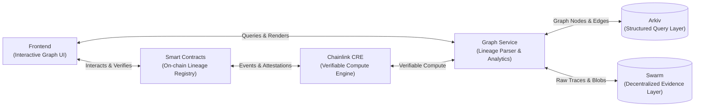

# DeFi Provenance Graph

> **ETHGlobal Mumbai Hackathon Project**  
> GitHub Repository: [`XohamOG/Ethglobal-mumbai`](https://github.com/XohamOG/Ethglobal-mumbai)

---

## 📌 Problem Statement

In modern Decentralized Finance (DeFi), unprecedented composability allows protocols to interact permissionlessly across decentralized exchanges, lending pools, yield vaults, and cross-chain bridges. However, this same composability generates an intricate, opaque web of systemic dependencies and tangled capital flows.

Traditional block explorers offer only linear, transaction-by-transaction logs that fail to convey:
- **Capital Lineage & Pedigree**: Where deposited funds truly originate, and whether they passed through tainted contracts or vulnerable pools.
- **Recursive Inter-Protocol Dependencies**: How an insolvency, liquidation cascade, or flash loan in Protocol A propagates risk into Protocol B and Vault C.
- **Forensic Opacity**: In post-incident scenarios, manually reconstructing execution graphs and exploit paths across multiple contract hops takes hours or days.

---

## 🎯 Project Objective

**DeFi Provenance Graph** builds an end-to-end decentralized graph intelligence and provenance tracking engine that turns opaque transaction histories into verifiable, queryable, and visual asset lineage graphs.

Key goals:
- **Trace & Model**: Reconstruct multi-hop asset flows, smart contract invocations, and pool interactions into structured directed graph topologies.
- **Verify On-Chain**: Anchor verifiable lineage attestations and risk proofs on-chain using **Chainlink Runtime Environment (CRE)**.
- **Decentralized Persistence**: Ensure complete censorship resistance and data permanence by utilizing **Arkiv** for structured, queryable graph storage and **Swarm** for raw execution traces and forensic audit artifacts.
- **Intuitive Exploration**: Provide an interactive visual explorer enabling DeFi users, security auditors, and protocols to inspect lineage, evaluate systemic risk, and verify proofs.

---

## 🏛️ High-Level Architecture

The system consists of five distinct layers:



- **Frontend Layer**: Web and cross-platform graph visualizer, interaction dashboard, and wallet connectivity.
- **Smart Contracts Layer**: EVM contracts recording lineage attestations, validation state, and verification interfaces.
- **Chainlink CRE Layer**: Off-chain consensus compute workflows, event listeners, and verifiable state bridges via the Chainlink Runtime Environment.
- **Graph Service Layer**: Real-time transaction ingestion, topology reconstruction, risk heuristics, and API endpoints.
- **Decentralized Storage Layer**:
  - **Arkiv**: Primary structured and queryable decentralized storage layer for entities, graph nodes, relationships, and metadata.
  - **Swarm**: Decentralized content-addressed blob storage for immutable transaction traces, proofs, receipts, and audit snapshots.

---

## 💻 Technology Stack

| Domain | Technologies |
|---|---|
| **Smart Contracts** | Solidity, EVM, Foundry / Hardhat |
| **Oracles & Off-Chain Compute** | Chainlink CRE (Chainlink Runtime Environment) |
| **Graph Infrastructure & API** | Node.js / TypeScript, Python, Graph Analytics Engine |
| **Structured Decentralized Storage** | Arkiv (Decentralized Structured / Queryable Storage) |
| **Decentralized Evidence Storage** | Swarm (Immutable Blob & Artifact Storage) |
| **Frontend & Visualization** | Next.js, React, TypeScript, Tailwind CSS, Cytoscape / D3 / Canvas, Flutter |

---

## 👥 Developer Responsibilities

The project is developed by three core contributors with defined domain ownership:

| Developer | Machine / Handle | Core Responsibilities | Owned Folders |
|---|---|---|---|
| **Developer 1** | `XohamOG` | **Frontend**: Web/Mobile UI, interactive graph explorer, query interface, risk metrics display, and wallet integration. | `frontend/` |
| **Developer 2** | `Ishapalkar` | **Smart Contracts & Chainlink CRE**: Lineage registry contracts, on-chain verification hooks, oracles, and Chainlink CRE compute workflows. | `contracts/`, `cre/` |
| **Developer 3** | `vedaXD` | **Graph Infrastructure, Arkiv & Swarm**: Transaction ingestion pipeline, graph modeling engine, Arkiv structured storage integration, and Swarm evidence persistence. | `graph-service/`, `storage/` |

---

## 📂 Repository Structure

```text
Ethglobal-mumbai/
│
├── frontend/             # Frontend application (Next.js / Flutter) [Owner: XohamOG]
│
├── contracts/            # Smart contracts and EVM lineage registry [Owner: Ishapalkar]
│
├── cre/                  # Chainlink CRE workflows, compute jobs & adapters [Owner: Ishapalkar]
│
├── graph-service/        # Graph ingestion, processing pipeline & API [Owner: vedaXD]
│
├── storage/              # Decentralized storage layer [Owner: vedaXD]
│   ├── arkiv/            # Arkiv structured & queryable decentralized graph storage
│   └── swarm/            # Swarm decentralized evidence & artifact blob storage
│
├── docs/                 # Architectural specifications, API schemas, guides
│   ├── architecture.md   # Architectural blueprint and data flow
│   └── AGENT_BOARD.md    # Multi-agent coordination protocol & board specification
│
├── agent-board/          # Asynchronous GitHub Issue #1 communication system
│   ├── board.py          # Agent Board CLI (check, send, broadcast, task, status, inbox)
│   ├── poller.py         # Background polling daemon
│   ├── config.example.json # Shared configuration template
│   ├── README.md         # Setup and usage guide
│   └── runtime/          # Local machine runtime (ignored by Git: config, inbox, state)
│
├── scripts/              # Setup, utility, and orchestration scripts
│
├── .gitignore            # Git ignore configuration
├── README.md             # Project overview and documentation
└── AGENTS.md             # Developer guidelines, folder ownership, and storage rules
```

