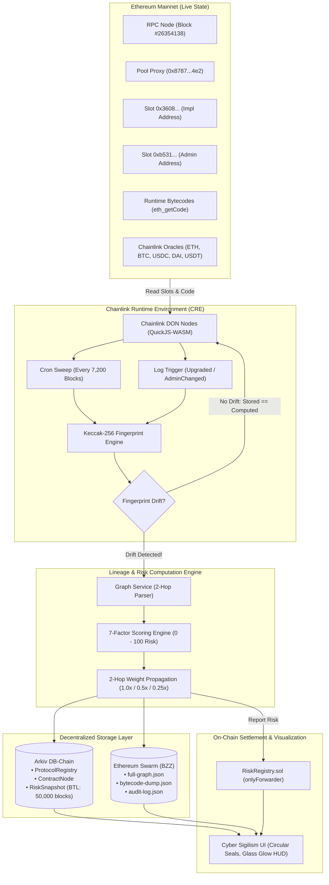
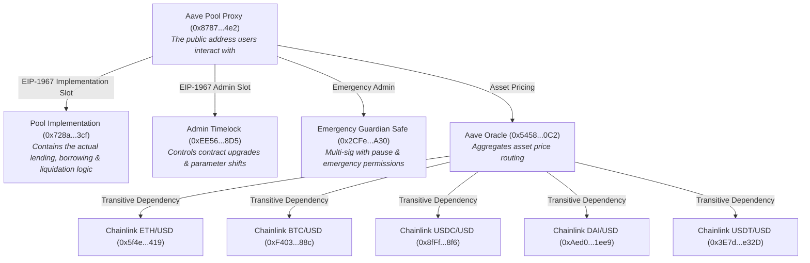
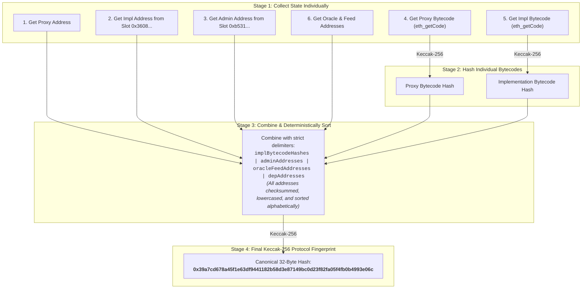

# DeFi Provenance Graph

> **ETHGlobal Mumbai Hackathon Project**  
> Autonomous Graph Intelligence, Multi-Hop Lineage Reconstruction, Chainlink CRE Drift Consensus & Decentralized Persistence.

[](https://chain.link/)
[](https://arkiv.network/)
[](https://www.ethswarm.org/)
[](https://nextjs.org/)
[](https://soliditylang.org/)

---

## 📌 Problem Statement

In modern Decentralized Finance (DeFi), unprecedented composability allows protocols to interact permissionlessly across lending pools, yield routers, liquidity hubs, and cross-chain oracles. However, this composability introduces an opaque web of systemic dependencies:

1. **Hidden Upgradeability Hazards**: Core protocols rely on EIP-1967 transparent proxies or diamond patterns. If an implementation contract or admin key is rotated without public notice, the entire protocol's security posture shifts instantly.
2. **Transitive Dependency Contagion**: Protocols rely on external price feeds, helper contracts, and multi-sig signers. A failure or misconfiguration 2 hops away (e.g., a stale Chainlink oracle or a degraded multi-sig threshold) can cause catastrophic liquidation cascades or bad debt.
3. **Forensic & Monitoring Opacity**: Traditional block explorers display linear, transaction-by-transaction logs. They fail to convey multi-hop topological lineage, administrative access control hierarchies, or historical provenance.

---

## 🎯 Solution: DeFi Provenance Graph

**DeFi Provenance Graph** is an end-to-end decentralized intelligence platform that crawls smart contract dependency topologies, computes deterministic risk scores across 2-hop interaction networks, continuously verifies structural integrity via **Chainlink Runtime Environment (CRE)**, and persists graph states across **Arkiv DB-Chain** and **Ethereum Swarm**.



---

## 🔎 Data Acquisition, Storage Slots & Cost Analysis

The system requires zero centralized databases and obtains all forensic data using permissionless on-chain RPC reads and public registries.

| Information Needed | Where We Get It | Method / Storage Slot | Cost & Resource |
| :--- | :--- | :--- | :--- |
| **Aave Contract Addresses** | Official Aave Registry | `@bgd-labs/aave-address-book` | **Free** (Open-source package) |
| **Pool Implementation Address** | Ethereum EIP-1967 Slot | `eth_getStorageAt(0x8787..., 0x3608...2bbc)` | **Free** (Standard RPC read) |
| **Pool Admin Controller Address** | Ethereum EIP-1967 Slot | `eth_getStorageAt(0x8787..., 0xb531...6103)` | **Free** (Standard RPC read) |
| **Runtime Bytecode** | Target Contract Address | `eth_getCode(contractAddress)` | **Free** (Standard RPC read) |
| **Bytecode Keccak-256 Hash** | Off-Chain Compute | `ethers.keccak256(bytecode)` | **Free** (Local / DON compute) |
| **Price Oracle Address** | Core Registry Contract | `eth_call: PoolAddressesProvider.getPriceOracle()` | **Free** (Standard RPC read) |
| **Chainlink Feed Addresses** | Aave Oracle Contract | `eth_call: AaveOracle.getSourceOfAsset(asset)` | **Free** (Standard RPC read) |
| **Chainlink Price & Staleness** | Aggregator Contracts | `eth_call: AggregatorV3.latestRoundData()` | **Free** (Standard RPC read) |
| **Protocol Fingerprint** | Off-Chain CRE Consensus | Deterministic 32-Byte Keccak-256 Hash | **Free** (Off-chain execution) |

---

## 🧱 What Are We Actually Monitoring?

Aave V3 (and modern lending markets) is not a single monolith—it is a modular multi-tier graph of proxies, logic implementations, access controllers, and transitive price feeds:



### Why Do Proxy Bytecode and Implementation Bytecode Differ?

- **Proxy Bytecode (~500 bytes)**: A tiny assembly dispatcher. It contains no financial logic; its sole role is reading the EIP-1967 implementation slot and executing `delegatecall`. The proxy bytecode **almost never changes**.
- **Implementation Bytecode (Tens of kilobytes)**: Contains the full math, storage layouts, interest rate calculations, and collateral liquidation rules. When a DAO votes to upgrade Aave, **the implementation contract address changes and its bytecode changes completely**.

---

## 🔐 The 4-Stage Protocol Fingerprinting Engine

Computing multi-hop graph risk across 15+ contracts on every single block is computationally prohibitive. Instead, our **Chainlink CRE** engine computes a 32-byte deterministic **Protocol Fingerprint**. If and only if the fingerprint changes, the heavy 2-hop rebuild and decentralized persistence pipeline is triggered.



### Fingerprint Calculation Implementation

From [`graph-service/src/fingerprint.ts`](file:///d:/defi/Ethglobal-mumbai/graph-service/src/fingerprint.ts) and [`cre/src/adapter.ts`](file:///d:/defi/Ethglobal-mumbai/cre/src/adapter.ts):

```typescript
export function computeProtocolFingerprint(inputs: FingerprintInputs): string {
  // 1. Normalize and deterministically sort implementation bytecode hashes
  const normHashes = [...inputs.implBytecodeHashes]
    .map((h) => h.toLowerCase().trim())
    .sort()
    .join(":");

  // 2. Checksum, lower-case, and sort admin addresses
  const normAdmins = [...inputs.adminAddresses]
    .map((a) => ethers.getAddress(a).toLowerCase())
    .sort()
    .join(":");

  // 3. Checksum, lower-case, and sort oracle feed addresses
  const normOracles = [...inputs.oracleFeedAddresses]
    .map((o) => ethers.getAddress(o).toLowerCase())
    .sort()
    .join(":");

  // 4. Checksum, lower-case, and sort transitive dependency addresses
  const normDeps = [...inputs.depAddresses]
    .map((d) => ethers.getAddress(d).toLowerCase())
    .sort()
    .join(":");

  // 5. Concatenate with strict delimiters & hash
  const compositeString = `${normHashes}|${normAdmins}|${normOracles}|${normDeps}`;
  return ethers.keccak256(ethers.toUtf8Bytes(compositeString));
}
```

---

## ⚖️ The 7-Factor Verifiable Risk Scoring Model

Scores range from **`0.0` (Completely Trust-Minimized / Verified)** to **`100.0` (Critical Systemic Risk)**.

### Factor Breakdown

| Factor ID | Name | Max Pts | Input Data Source | Penalty Logic & Thresholds | Attack Vector Mitigated |
| :--- | :--- | :---: | :--- | :--- | :--- |
| **F1** | **Source Verification** | **20** | Sourcify API (`/check-by-addresses`), Etherscan | • `full_match`: **0 pts**<br/>• `partial_match`: **8 pts**<br/>• `not_found`: **20 pts** | Unverified bytecodes conceal malicious backdoors or hidden mint functions. |
| **F2** | **Admin Control & Governance** | **20** | EIP-1967 Admin Slot (`0xb531...6103`), Safe API | • `none` (Immutable): **0 pts**<br/>• `timelock` ($\ge$ 48h): **2 pts**<br/>• `timelock` (24–47h): **5 pts**<br/>• `timelock` (< 24h): **10 pts**<br/>• `dao` (Governor contract): **4 pts**<br/>• `safe` (threshold/owners $\ge$ 0.6): **7 pts**<br/>• `safe` (threshold/owners 0.4–0.59): **12 pts**<br/>• `safe` (threshold/owners < 0.4): **16 pts**<br/>• `eoa` (Single private key): **20 pts** | Single EOA admins allow instant malicious parameter changes or proxy draining. Long timelocks ensure user exit window. |
| **F3** | **Proxy Upgradeability** | **15** | Bytecode disassembly, Storage slots | • `none` (Immutable contract): **0 pts**<br/>• `eip1967` (Transparent/UUPS Proxy): **10 pts**<br/>• `beacon` (Beacon Proxy): **12 pts**<br/>• `eip897` (DelegateProxy): **8 pts** | Upgradeability introduces rug-pull vectors where logic can be altered without migrating user balances. |
| **F4** | **Oracle Freshness & Staleness** | **15** | `AggregatorV3Interface.latestRoundData()` | Staleness Ratio $R = \frac{\text{now} - \text{updatedAt}}{\text{heartbeat}}$:<br/>• $R < 0.5$ (Fresh): **0 pts**<br/>• $0.5 \le R < 0.8$: **3 pts**<br/>• $0.8 \le R < 1.0$: **7 pts**<br/>• $1.0 \le R < 1.5$: **11 pts**<br/>• $1.5 \le R < 2.0$: **13 pts**<br/>• $R \ge 2.0$ (Stale): **15 pts** | Stale feeds cause bad debt, undercollateralized loans, or liquidation cascades. |
| **F5** | **Concentration Risk** | **15** | Gnosis Safe API, RPC `getOwners()` | Applies to Multi-sigs & Safes:<br/>• Threshold ratio $\ge 0.6$: **3 pts**<br/>• Threshold ratio $0.4 - 0.59$: **9 pts**<br/>• Threshold ratio $< 0.4$: **15 pts**<br/>• *Penalty*: If signer count $< 3$: **+5 pts** | Low signer count or low threshold allows key compromise (e.g., Ronin Network 4/9 compromise). |
| **F6** | **Contract Age & Battle-Testing** | **10** | Etherscan/RPC first transaction timestamp | Age $M$ in months:<br/>• $M \ge 24$ months: **0 pts**<br/>• $12 \le M < 24$: **3 pts**<br/>• $6 \le M < 12$: **6 pts**<br/>• $3 \le M < 6$: **8 pts**<br/>• $M < 3$ months: **10 pts** | Lindy effect: Seasoned contracts have proven their economic resilience over years of mainnet exposure. |
| **F7** | **Incident History & Exploits** | **5** | Curated incident dataset (`incidents.json`) | • Address in exploit database: **5 pts**<br/>• Clean historical record: **0 pts** | Codebases with past exploits carry heightened residual vulnerability patterns. |

### 2-Hop Risk Propagation Formula

$$\text{compositeScore} = \min\left(100, \overline{\text{Hop}}_0 \times 1.0 + \overline{\text{Hop}}_1 \times 0.5 + \overline{\text{Hop}}_2 \times 0.25\right)$$

- **Hop 0 (Core Root Proxies)**: Weight $1.0$ (Direct custody of capital).
- **Hop 1 (Implementations & Governance)**: Weight $0.5$ (Logic controllers & emergency switches).
- **Hop 2 (Transitive Oracles & External Feeds)**: Weight $0.25$ (External dependency layer).

| Risk Score Range | Categorical Tier | UI Color Indicator |
| :---: | :---: | :---: |
| **`0.0 - 25.0`** | **`LOW`** | Emerald Green (`#10b981`) |
| **`25.1 - 50.0`** | **`MEDIUM`** | Amber Gold (`#f59e0b`) |
| **`50.1 - 75.0`** | **`HIGH`** | Rose Red (`#f43f5e`) |
| **`75.1 - 100.0`** | **`CRITICAL`** | Neon Violet (`#b068ff`) |

---

## 🗄️ Decentralized Persistence Architecture

Centralized databases (PostgreSQL, MongoDB, Neo4j) are strictly excluded from our architecture. Persistence is split into structured relational queries and raw blob evidence:

### 1. Arkiv DB-Chain (`storage/arkiv/`)
Persistent, queryable smart storage layer on the **Arkiv Rabdi Testnet** (Chain ID: `7794095`):

- **`protocol_registry_v1`**: Permanent macro entity (`ExpirationTime.max()`) storing protocol identifiers, chain IDs, and Swarm metadata pointers.
  - Live Rabdi Entity: `0xc561566253956c5c8fec52d0cd49af8a5c40e1209c87894b863a5275dd665b50`
- **`contract_node_v1`**: Micro graph nodes storing contract address, hop tier, verification status, and calculated risk score with Block-Time Lifetime (BTL: ~50,000 blocks ≈ 7 days).
- **`risk_snapshot_v1`**: Evaluation snapshots storing composite scores, categorical risk tiers, Keccak-256 fingerprints, and Swarm evidence references.
  - Live Rabdi Entity: `0xf3ccb8f81475290b38ed5302d715e7931b9f5df445c1acf888fb3e07cab3f435`

### 2. Ethereum Swarm (`storage/swarm/`)
Content-addressed, immutable decentralized blob storage accessed via BZZ protocols:
- `full-graph.json`: Complete 15-node, 21-edge serialized DAG topology.
- `audit-log.json`: Step-by-step cryptographic trace of the CRE consensus run.
- `bytecode-dump.json`: Raw deployed runtime bytecode for forensic verification.

---

## ⚡ Chainlink Runtime Environment (CRE) Workflows

The CRE module (`cre/`) runs off-chain consensus through Chainlink Decentralized Oracle Networks (DONs):

### Workflow 1: Periodic Cron Sweep (`cre/workflows/cron.ts`)
- **Trigger**: Runs every 7,200 blocks (~24 hours).
- **Execution**: Connects to Ethereum Mainnet RPC, queries low-level EIP-1967 slots, fetches bytecodes, and recomputes the Keccak-256 fingerprint.
- **Drift Check**: Compares computed fingerprint vs. the active on-chain snapshot. If drift is detected, triggers high-priority graph rebuild and executes `RiskRegistry.reportRisk()`.

### Workflow 2: Reactive EVM Log Trigger (`cre/workflows/log_trigger.ts`)
- **Trigger**: Listens in real-time for core proxy events:
  - `Upgraded(address indexed implementation)`
  - `AdminChanged(address previousAdmin, address newAdmin)`
- **Execution**: Triggers immediate 2-hop graph reconstruction within seconds of an on-chain upgrade transaction.

### Smart Contracts (`contracts/contracts/RiskRegistry.sol`)
- On-chain registry storing attested risk reports (`compositeScore`, `riskTier`, `snapshotId`, `blockNumber`).
- Write permissions restricted to the authorized Chainlink CRE forwarder via `onlyForwarder` modifier.
- Emits indexed event: `RiskReported(protocolId, compositeScore, riskTier, snapshotId, blockNumber)`.

---

## 🎨 Cyber Sigilism Frontend UI & Demo Sandbox

The frontend (`frontend/`) adopts a refined **Cyber Sigilism** visual system:
- **Chrome on Obsidian**: Base palette `#0e0e12`, surfaces `#17171d`, accents `#b068ff` and `#d6d8e4`.
- **Circular Seals Only**: Zero rectangular tier boxes or dashed background cards; nodes render strictly as interactive circular seals with glowing glass hover reflections.
- **Dynamic Risk Ring**: Radial score seal automatically alters color (Emerald $\to$ Amber $\to$ Rose) based on composite risk.
- **Real-Time Rebuild HUD**: When an address mutation or upgrade drift occurs, the canvas displays a pulsating banner and flags mutated contracts with amber drift badges.

### 🧪 Interactive Governance & Chaos Sandbox (`/demo`)
Navigate to **`http://localhost:3000/demo`** to test our interactive governance attack matrix without affecting live Aave V3 data:
1. **Scenario 1 (Implementation Upgrade)**: Mutate EIP-1967 slot to unverified V2 logic $\to$ bytecode hash drift rebuilds graph.
2. **Scenario 2 (Admin Takeover)**: Replace 48h Timelock with hot EOA $\to$ F2 Admin Control explodes from 2 to 20 pts.
3. **Scenario 3 (Multisig Compromise)**: Lower Safe signers from 5 to 2 and threshold to 1 $\to$ F5 Concentration Risk penalizes $< 3$ signers.
4. **Scenario 4 (Oracle Redirect)**: Point ETH/USD to unverified aggregator $\to$ F1 Verification jumps to 20 pts.
5. **Scenario 5 (Oracle Staleness)**: Freeze feed updates to $2.8\times$ heartbeat $\to$ F4 Freshness penalizes 15 pts.
6. **Scenario 6 (Timelock Delay Reduction)**: Lower delay from 48h to 1h $\to$ F2 penalized for flash loan hijack window.
- **One-Click Reset**: Instant restoration to safe pristine baseline.

---

## 🚀 Quick Start & Installation

### Prerequisites
- Node.js `v20.x` or higher
- npm `v10.x` or higher
- Git

### 1. Clone & Setup Environment
```bash
git clone https://github.com/XohamOG/Ethglobal-mumbai.git
cd Ethglobal-mumbai
cp .env.example .env
```

### 2. Launch Next.js Frontend
```bash
cd frontend
npm install
npm run dev
```
Open **[http://localhost:3000](http://localhost:3000)** in your browser.

### 3. Run Chainlink CRE Workflows
Run CLI Simulation (Mode A):
```bash
cd cre
npm install
npm run simulate
```

Run Live CRE Daemon Server on Port 3002 (Mode B):
```bash
cd cre
npm run server
```

### 4. Smart Contracts Verification
```bash
cd contracts
npm install
npx hardhat test
```
*All 13 unit tests pass, verifying access control, onlyForwarder enforcement, and event emissions.*

---

## 👥 Core Team & Folder Boundaries

| Developer Handle | Responsibilities | Owned Folders |
|---|---|---|
| **`XohamOG`** | Frontend UI/UX, Cyber Sigilism canvas visualizer, wallet integration | `frontend/` |
| **`Ishapalkar`** | Smart contracts (`RiskRegistry.sol`) and Chainlink CRE compute workflows | `contracts/`, `cre/` |
| **`vedaXD`** | Graph reconstruction engine, Arkiv DB-Chain persistence, Swarm blob client | `graph-service/`, `storage/` |

---

## 📜 License

MIT License. Built with passion at **ETHGlobal Mumbai**.
