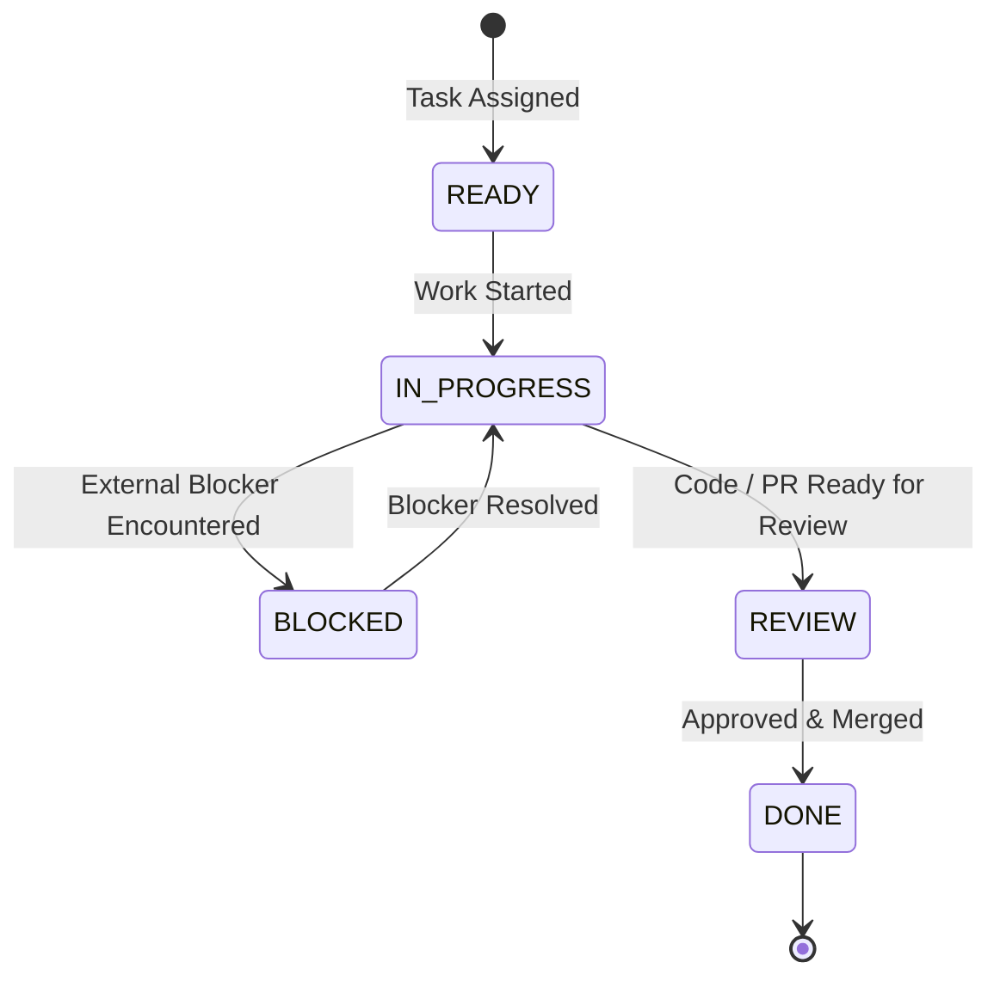

# Agent Board Specification & Coordination Protocol

## 1. Overview

The **Agent Board** is the asynchronous, multi-machine communication backbone for the **DeFi Provenance Graph** project during ETHGlobal Mumbai. Because three distinct developers and autonomous agents operate on physically separate machines, GitHub Issue #1 serves as our single source of truth for task dispatching, status tracking, architectural coordination, and interface contracts.

- **Communication Hub**: [GitHub Issue #1](https://github.com/XohamOG/Ethglobal-mumbai/issues/1)
- **Primary Agents**:
  - `XohamOG` (PC 1) — Frontend
  - `Ishapalkar` (PC 2) — Smart Contracts & Chainlink CRE
  - `vedaXD` (PC 3) — Graph Infrastructure, Arkiv & Swarm

---

## 2. Architecture & File Layout

Each PC maintains an isolated, uncommitted `runtime/` directory inside `agent-board/`:

```text
Ethglobal-mumbai/
├── agent-board/
│   ├── board.py            # CLI tool for posting and inspecting messages
│   ├── poller.py           # Background listener fetching addressed comments
│   ├── config.example.json # Shared template configuration
│   ├── README.md           # Quickstart and CLI manual
│   │
│   └── runtime/            # ⚠️ LOCAL RUNTIME DIRECTORY (IGNORED BY GIT)
│       ├── config.json     # Local machine configuration
│       ├── inbox.json      # Local received messages inbox
│       └── state.json      # Independent comment ID sync checkpoint
└── docs/
    └── AGENT_BOARD.md      # Protocol specification and integration rules
```

> [!IMPORTANT]
> **Independent State & Isolation**: Each poller maintains an independent `runtime/state.json` recording its highest processed comment ID. This prevents one PC's polling activity from interfering with or resetting another PC's message tracking. Git completely ignores `agent-board/runtime/`.

---

## 3. Communication Protocol

All messages posted to Issue #1 follow structured Markdown headers to ensure deterministic parsing by `poller.py` and human readability for developers.

### 3.1 Targeted Message
Used to direct a question or notice to a specific agent:
```markdown
### 📨 Targeted Message
**TO:** @Ishapalkar
**FROM:** @XohamOG
**TIMESTAMP:** 2026-11-05 18:30:00 UTC

@Ishapalkar Please review the proposed contract ABI in docs/contracts-api.md.
```

### 3.2 Broadcast Announcement
Used for team-wide notices (e.g., milestone completions or breaking schema updates):
```markdown
### 📢 Broadcast Message
**TO:** @all
**FROM:** @XohamOG
**TIMESTAMP:** 2026-11-05 18:35:00 UTC

@all Frontend mock server is running on port 3000.
```

### 3.3 Task Assignment
Used to assign a trackable work unit:
```markdown
### 📋 Task Assignment
**TASK:** TASK-002
**TO:** @vedaXD
**FROM:** @XohamOG
**TITLE:** Export Arkiv Query Mock Data
**STATE:** READY
**TIMESTAMP:** 2026-11-05 18:40:00 UTC

**DESCRIPTION:**
Provide mock JSON fixtures for multi-hop graph queries so the frontend graph visualizer can test edge rendering.
```

### 3.4 Task Status Update
Used to communicate progress state transitions:
```markdown
### 🔄 Task Status Update
**STATUS:** TASK-002
**FROM:** @vedaXD
**STATE:** IN_PROGRESS
**TIMESTAMP:** 2026-11-05 18:45:00 UTC

**MESSAGE:**
Created docs/fixtures/mock-graph.json with 15 nodes and 22 directed edges.
```

---

## 4. State Lifecycle

Tasks progress through the following standardized states:



- `READY`: Task created and waiting for the assignee to begin.
- `IN_PROGRESS`: Assignee actively developing the task on their feature branch.
- `BLOCKED`: Development halted due to missing dependencies, API specifications, or upstream blockers.
- `REVIEW`: Feature completed and awaiting review by dependent agents.
- `DONE`: Completed, tested, and integrated.

---

## 5. Poller Mechanics & Safety

### 5.1 Address Matching Rules
`poller.py` inspects each new comment and flags it for the local inbox if any of the following patterns match (case-insensitive):
1. `@{username}` (e.g., `@XohamOG`)
2. `@all`
3. `TO: @{username}` or `TO: {username}`
4. `ASSIGNED TO: @{username}`

### 5.2 Author Exclusion
Comments authored by the local agent (`comment.user.login == config.username`) are automatically filtered out to prevent echo loops.

### 5.3 First-Run Baseline
On the very first execution on a new machine:
1. `poller.py` fetches the current comment list from Issue #1.
2. It sets `last_comment_id` in `state.json` to the highest comment ID present.
3. Historical comments are skipped, preventing stale messages from flooding the fresh inbox.

### 5.4 Zero-Execution Guarantee
The poller and CLI are strictly transport tools:
- They **never** pass comment strings to a shell, python `eval()`, or `subprocess`.
- They do **not** trigger or wake Antigravity or any automated code generator.
- All actions require developer oversight.

---

## 6. Setup & Operational Guide

### 6.1 Requirements
- Python 3.9+ (Standard Library only)
- GitHub CLI (`gh`) authenticated with repository access

### 6.2 Windows PowerShell Commands

```powershell
# 1. Authenticate with GitHub
gh auth login

# 2. Configure machine runtime
New-Item -ItemType Directory -Path agent-board/runtime -Force
Copy-Item agent-board/config.example.json agent-board/runtime/config.json
# (Ensure username in agent-board/runtime/config.json matches your GitHub account)

# 3. Verify connection
python agent-board/board.py check

# 4. Start background poller in a separate window
python agent-board/poller.py

# 5. Send messages or check inbox
python agent-board/board.py send Ishapalkar "Ready for testing"
python agent-board/board.py inbox
```

### 6.3 Unix / macOS Commands

```bash
# 1. Authenticate with GitHub
gh auth login

# 2. Configure machine runtime
mkdir -p agent-board/runtime
cp agent-board/config.example.json agent-board/runtime/config.json

# 3. Verify connection
python3 agent-board/board.py check

# 4. Start background poller
python3 agent-board/poller.py

# 5. Check inbox
python3 agent-board/board.py inbox
```

