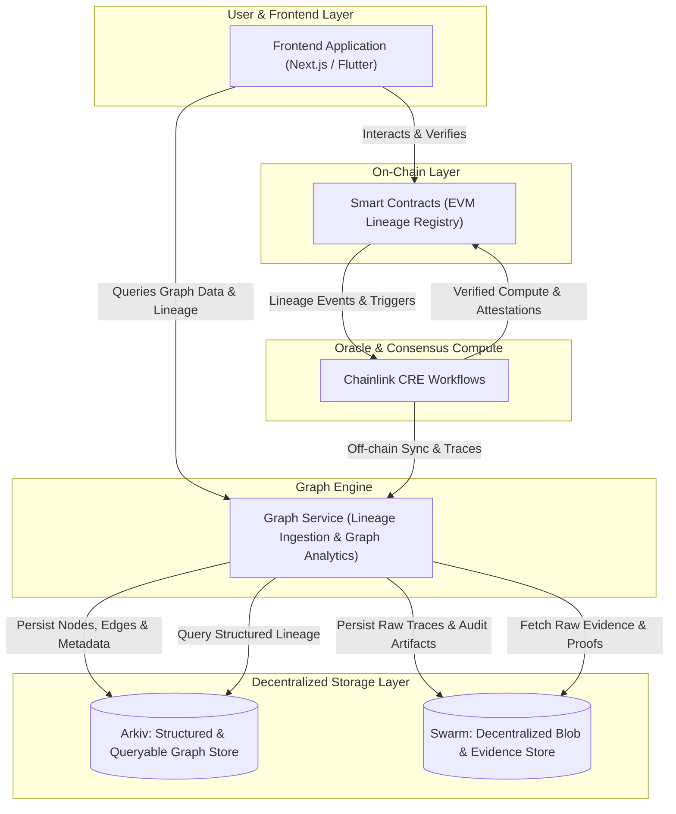

# Architecture Overview: DeFi Provenance Graph

## 1. System Vision

The **DeFi Provenance Graph** is a decentralized intelligence platform that reconstructs, verifies, and visualizes asset lineages, protocol interaction paths, and dependency graphs across the DeFi ecosystem. By combining smart contract verification, Chainlink Runtime Environment (CRE) compute workflows, Arkiv structured decentralized queries, and Swarm decentralized blob storage, the platform provides trustless visibility into capital flows and systemic risks.

---

## 2. High-Level Architecture Diagram

---

## 3. Core Subsystems

### 3.1 Frontend Layer (`frontend/`)
- **Owner**: `XohamOG`
- **Role**: Provides the interactive visual graph explorer, protocol lineage visualizer, risk dashboards, and wallet connection.
- **Key Capabilities**:
  - Interactive force-directed / node-link graph visualization of token and pool histories.
  - Deep-dive inspection into specific protocol interactions, flash loan paths, and liquidity waterfalls.
  - On-chain proof verification interface.

### 3.2 Smart Contracts Layer (`contracts/`)
- **Owner**: `Ishapalkar`
- **Role**: EVM-based lineage registry, attestation anchors, and verification contracts.
- **Key Capabilities**:
  - Records cryptographic roots or state attestations of asset lineages.
  - Exposes query interfaces and verification hooks for protocols consuming provenance data.
  - Emits canonical provenance events monitored by Chainlink CRE.

### 3.3 Chainlink CRE Layer (`cre/`)
- **Owner**: `Ishapalkar`
- **Role**: Off-chain verifiable compute and oracle consensus via the Chainlink Runtime Environment.
- **Key Capabilities**:
  - Monitors smart contract events and cross-chain execution logs.
  - Performs decentralized consensus computation over complex multi-hop transactions.
  - Bridges verifiable lineage proofs back on-chain and triggers storage sync.

### 3.4 Graph Service Layer (`graph-service/`)
- **Owner**: `vedaXD`
- **Role**: Ingestion pipeline, graph builder, topological analysis, and API query engine.
- **Key Capabilities**:
  - Consumes transaction traces and parses fund transfers, pool swaps, and contract invocations into graph nodes and directed edges.
  - Calculates graph-based risk heuristics (e.g., circular flow detection, flash loan involvement, tainted lineage).
  - Exposes clean API contracts for the frontend.

### 3.5 Decentralized Storage Layer (`storage/`)
- **Owner**: `vedaXD`
- **Storage Policy**: Fully decentralized storage architecture. **No centralized primary databases (e.g., PostgreSQL, Neo4j) are permitted as primary stores.**
- **Components**:
  - **Arkiv (`storage/arkiv/`)**: Primary structured, queryable decentralized database and graph layer storing indexed entities, graph nodes, relationships, and queryable metadata.
  - **Swarm (`storage/swarm/`)**: Decentralized content-addressed blob storage preserving immutable raw transaction traces, execution evidence, audit snapshots, and cryptographic receipts.

---

## 4. End-to-End Data Flow

1. **Transaction Ingestion**: On-chain interactions emit provenance logs or are tracked by Chainlink CRE and the Graph Service.
2. **Provenance Processing**: The Graph Service processes transaction receipts, builds relational edges between tokens, accounts, and pools, and prepares the graph payload.
3. **Decentralized Persistence**:
   - Structured graph records and indices are committed to **Arkiv**.
   - Raw transaction traces, execution artifacts, and forensic proof documents are archived to **Swarm**.
4. **On-Chain Attestation**: Critical provenance checkpoints and state commitments are validated via **Chainlink CRE** and registered in the **Smart Contracts**.
5. **Visualization**: The **Frontend** queries the Graph Service, reads verified graph topology from **Arkiv**, retrieves supporting evidence blobs from **Swarm**, and presents the visual provenance graph to the user.

